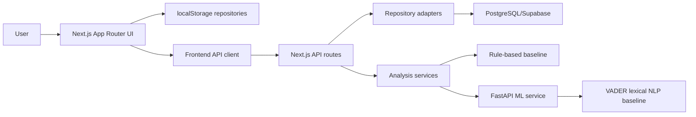
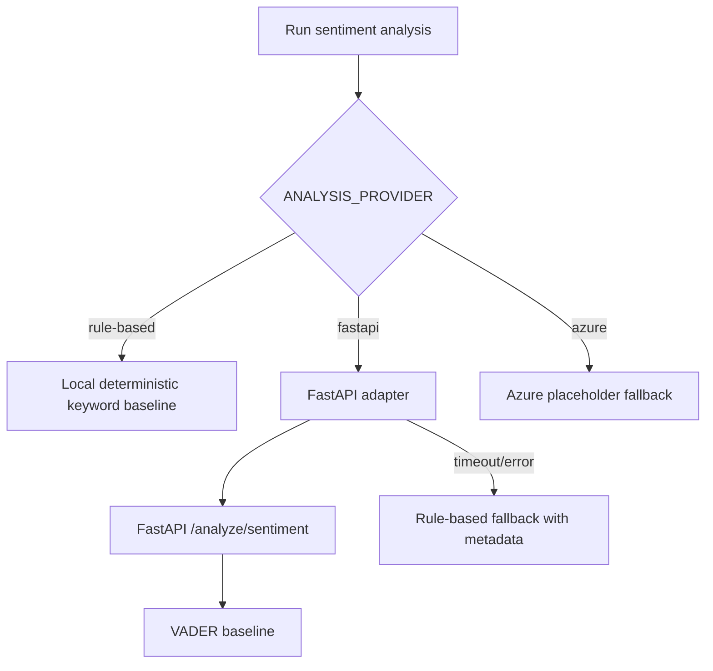

# Universal Opinion Intelligence Platform: System Architecture

## 1. Architectural Overview

The platform is designed as a modular, replaceable architecture. The frontend and workflow logic are implemented in Next.js, while persistence and ML inference are abstracted behind service and repository layers. This allows the application to operate in localStorage mode during development, API-shadow mode during migration, and API/PostgreSQL mode for production-style persistence.



## 2. Runtime Modes

| Mode | Source of Truth | Purpose |
| --- | --- | --- |
| `local` | Browser localStorage | Default development and demo mode |
| `api-shadow` | Browser localStorage | Calls APIs in parallel for diagnostics without breaking local flow |
| `api` | Next.js API + PostgreSQL | Backend persistence and user-scoped access |

Relevant environment variable:

```bash
NEXT_PUBLIC_DATA_MODE=local | api-shadow | api
DATA_ACCESS_MODE=local | postgres
```

## 3. Authentication Architecture

The platform supports two authentication modes:

| Mode | Description |
| --- | --- |
| `AUTH_MODE=dev` | Development user fallback for local API testing |
| `AUTH_MODE=supabase` | Supabase email/password session integration |

In API mode, all project, dataset, analysis, recommendation, and report access is scoped through the current user and project ownership. Workspace data is further scoped through workspace membership and role checks.

## 4. API Layer

The API layer uses Next.js Route Handlers. Routes validate request bodies, return structured success/error envelopes, and log request metadata.

Implemented route groups:

- `/api/health`
- `/api/projects`
- `/api/projects/[projectId]`
- `/api/datasets`
- `/api/datasets/[datasetId]`
- `/api/analysis`
- `/api/analysis/prepare`
- `/api/analysis/run-sentiment`
- `/api/analysis/run-deep`
- `/api/recommendations/generate`
- `/api/reports`
- `/api/reports/generate`
- `/api/reports/export`
- `/api/workspaces`
- `/api/workspaces/[workspaceId]/members`
- `/api/workspaces/[workspaceId]/members/[memberId]`
- `/api/evaluation/run`

## 5. Repository Pattern

Repositories isolate data access from UI and service logic.

### Local Repositories

Local repositories use browser `localStorage` and support the complete project workflow in local mode.

Examples:

- `project-repository`
- `dataset-repository`
- `analysis-job-repository`
- `analysis-result-repository`
- `multi-dimensional-analysis-repository`
- `recommendation-repository`
- `report-snapshot-repository`
- `evaluation-repository`

### PostgreSQL Repositories

PostgreSQL repositories provide API-mode persistence and ownership checks.

Examples:

- `PostgresProjectRepository`
- `PostgresDatasetRepository`
- `PostgresAnalysisRepository`
- `PostgresWorkspaceRepository`

## 6. Service Layer

| Service | Responsibility |
| --- | --- |
| Data intake service | Create datasets from pasted text or CSV records |
| Text cleaning service | Trim text, normalize spaces, remove blanks and duplicates |
| Analysis preparation service | Generate prepared dataset and quality summary |
| Sentiment analysis service | Run current sentiment provider and fallback logic |
| Multi-dimensional analysis service | Generate emotion, stance, aspects, risk signals |
| Recommendation engine service | Generate deterministic evidence-based recommendations |
| Report generation service | Create report snapshots from saved analysis data |
| Report export service | Store PDF print export history |
| Model evaluation service | Calculate real benchmark metrics from labelled data |

## 7. Analysis Provider Architecture



Provider metadata is stored with results:

- provider
- modelName
- modelVersion
- confidence
- processingTimeMs
- fallbackFrom
- fallbackReason

## 8. Database Schema Summary

Primary PostgreSQL tables:

| Table | Purpose |
| --- | --- |
| `users` | Application users and ownership root |
| `projects` | Project metadata, goal, type, status, owner/workspace |
| `datasets` | Dataset envelope for pasted or uploaded data |
| `dataset_records` | Normalized individual text records |
| `prepared_datasets` | Cleaned dataset snapshot and quality summary |
| `analysis_jobs` | Processing lifecycle and job status |
| `sentiment_results` | Sentiment summaries and per-record sentiment results |
| `deep_analysis_results` | Emotion, stance, aspect, risk-signal outputs |
| `recommendations` | Evidence-based recommendations and roadmap |
| `report_snapshots` | Saved report payloads |
| `report_exports` | PDF print/export history |
| `workspaces` | Shared workspace entity |
| `workspace_members` | Workspace users and roles |

Migrations:

- `0001_init.sql`: core project, dataset, analysis, recommendation, and report tables.
- `0002_auth_user_scope.sql`: user ownership scope.
- `0003_workspaces_roles.sql`: workspace and membership roles.
- `0004_model_metadata.sql`: model metadata on analysis outputs.

## 9. ML/FastAPI Architecture

The FastAPI service is located in `ml-service/`.

Endpoints:

- `GET /health`
- `POST /analyze/sentiment`
- `POST /analyze/deep`

The current ML service uses:

- VADER sentiment for lightweight real sentiment scoring.
- Deterministic lexical logic for deep labels such as emotion, stance, aspects, and risk signals.
- Rule-based fallback if VADER cannot be imported.

The service is intentionally lightweight and replaceable. Future work can introduce transformer pipelines such as BERT, RoBERTa, or DistilBERT behind the same response contract.

## 10. Report and PDF Architecture

The report system separates report data from presentation:

1. `ReportSnapshot` stores deterministic report content from real saved data.
2. `ReportPreview` renders a web preview.
3. `PrintableReport` renders a print-friendly A4 layout.
4. Browser `window.print()` produces a PDF using print CSS.
5. `ReportExport` records export history.

## 11. Benchmark Evaluation Architecture

The evaluation module accepts labelled benchmark data:

```csv
text,expectedSentiment
"The product is excellent",positive
"The app is broken",negative
"The delivery arrived yesterday",neutral
```

The platform runs the active provider and computes:

- accuracy
- macro precision
- macro recall
- macro F1
- per-class metrics
- confusion matrix
- wrong-prediction table

Metrics are not preloaded or fabricated.

## 12. Screenshot Placeholders

- `[Screenshot Placeholder: High-level architecture diagram]`
- `[Screenshot Placeholder: Data mode developer panel]`
- `[Screenshot Placeholder: Evaluation route/API response]`
- `[Screenshot Placeholder: Supabase table editor after migrations]`
