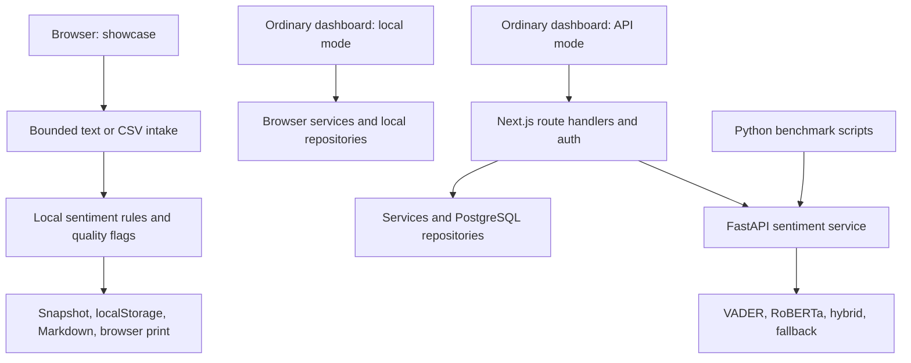
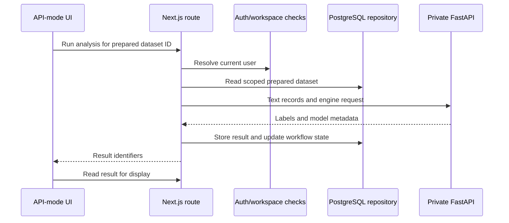
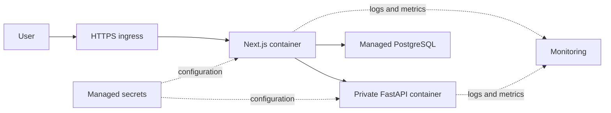

# Technical Architecture Audit

Audit date: 9 September 2026. Scope: local source, documentation, saved validation artifacts, and the current showcase verification. This is a scoped engineering audit, not a penetration-test certification or proof that every repository path works.

## Verdict

The architecture is reasonable for a college project: a Next.js user interface, explicit services and repositories, an optional FastAPI inference boundary, and reproducible benchmark artifacts. The strongest demonstration is the bounded `/showcase` workflow. The largest engineering gap is incomplete integration evidence across the browser, serving configuration, persistence, authentication, and export layers.

Three execution paths must be distinguished:

The solid arrows describe source-level paths; only the showcase path is the subject of the current browser verification. The API/database path is not validated merely by displaying this diagram.

## Area-by-area assessment

Risk is consequence if the gap is ignored, not a measured probability. “Before cloud use” is separate from “before local showcase.”

| Area and source | Current status and strengths | Loopholes / residual risk | Risk | Recommended fix and timing |
|---|---|---|---|---|
| Frontend (`src/app`, `src/components`) | App Router, typed React, shared UI primitives, dedicated demonstration route | Main dashboard and showcase duplicate orchestration; additional route behavior not comprehensively UI-tested | Medium | Rehearse only verified flow now; consolidate shared domain logic later |
| Routing (`src/app/api`, dashboard pages) | Explicit route handlers and local/API modes | A 200 local contract response does not mean database persistence; not all routes use identical configuration paths | Medium | Label modes now; full contract/E2E tests before API deployment |
| React structure (`showcase/page.tsx`) | Components for evidence/print/metrics; bounded input; cancellation and status feedback added | Large page still mixes sentiment, recommendation, schema, and rendering; timer-based work runs on main thread | Medium | Keep 250-row limit now; extract a pure analysis/report service and worker only if larger workloads are needed |
| TypeScript | Strict compiler settings; new saved-snapshot shape checks | FastAPI response uses a cast, not runtime schema validation; summary semantic integrity only partially checked on restore | Medium | Zod response contracts and validated invariant checks before API integration |
| Services/repositories | Main app separates analysis, recommendations, data services and adapters | Two repository families and mode-specific behavior can drift; integration tests sparse | Medium | Document the actual call graph now; consolidate later |
| Review-quality flagger | Reasons, evidence, manual actions; concrete terms broadened; empty normalized strings no longer count as exact duplicates | Uncalibrated weights, order-dependent duplicate marking, false positives, English normalization, pairwise O(n²) comparison | Medium | Maintain cap and disclose now; label a small set before making quality claims |
| Local sentiment | Visible engine/version/cues; basic clause-limited negation added | Small vocabulary, no learned context, neutral conflates no cues and ties; rule score not probability | High for analytical interpretation | Display limitations now; never attach RoBERTa benchmark accuracy to this path |
| Reports | Snapshot, partial print examples, full-row Markdown export with IDs and metadata | Recommendations are fixed thresholds; selection is first-in-order; print is browser-dependent; no outcome evaluation | Medium | Export/review a synthetic report now; full app PDF workflow remains a separate open check |
| localStorage | Schema/basic ID checks, error recovery, matching input restore; only its own key cleared | Latest-only; origin/profile-specific; unencrypted text; no tamper evidence; cross-tab overwrite and eviction possible | Medium | Export backup now; database/access/retention controls before shared use |
| CSV/demo handling | Explicit header recognition, multiline quoting, stable row IDs, limits; 3 × 15 synthetic records | One text column, no arbitrary mapping UI, no weighting/timestamp pipeline; heuristic text/CSV detection can confuse a first line named `text` | Low for prepared demo | Show accepted format now; more import formats later |
| FastAPI (`ml-service/main.py`) | Typed request/response shapes, optional engines, fallback metadata, cached model and startup prewarm | No direct-service auth/rate limit; missing upper bounds for records/text/batch and threshold range; lazy-load race; no retry after first failed load | High before external exposure | Keep private/off during showcase; bound and authenticate service before deployment |
| RoBERTa integration | Off-the-shelf model and explicit label map; optional heavy dependencies | Model version string `1.0.0` is not a pinned Hub revision; dependencies have broad ranges; GPU/hardware details not embedded in result JSON | Medium | Pin model commit and capture environment before reruns/release |
| Hybrid/serving | Neutral/uncertain/mixed cues route to RoBERTa; result order restored; full-chunk routing totals fixed | Heuristic VADER confidence is not calibrated; hybrid metadata/options not fully propagated by ordinary `ml-client.ts` | Medium | Present direct service benchmark accurately; carry batch/threshold/routing through app contracts later |
| Supabase/PostgreSQL | Parameterized queries, owner/workspace predicates, role checks on writes, migrations 0001–0004 | Live E2E and cross-tenant tests open; no RLS defense-in-depth; ID relationship consistency/transactions need tests | High before shared deployment | Defer from showcase; use two-user read/write tests, relation checks and rollback tests before cloud use |
| Database TLS (`src/server/db/client.ts`) | Connection pooling and optional SSL | `rejectUnauthorized:false` disables certificate verification | High before cloud use | Configure trusted CA/certificate verification; verify in target environment |
| Rate limiting (`src/lib/api/rate-limit.ts`) | Per-process fixed window and Retry-After; tested threshold behavior | Trusts first client-provided forwarded IP unless proxy sanitizes it; no shared store; invalid numeric env settings not rejected | High for public endpoint abuse | Trusted proxy and validated config; shared rate store before multi-instance deployment |
| Request body guard (`src/lib/api/logger.ts`) | Rejects advertised Content-Length over configured cap; downstream Zod record/text caps | Does not count streamed/undeclared bytes; generic handler error.message returned to caller | High before external use | Enforce actual streamed byte limits at proxy/handler and sanitize 500s |
| URL extraction (`src/lib/research/url-extraction.ts`) | Scheme/hostname checks, metadata, source limitations | Redirect checks occur after `fetch` followed redirects; hostname tests do not resolve DNS; body read is unbounded before slicing; timeout ends before body read | High before enabling collection | Disable during showcase; manual redirects with pre-request IP checks and bounded streaming reads before live use |
| Docker | Two container definitions; this audit adds root/service `.dockerignore` exclusions | Images not built/run in this audit; root keeps all dependencies, no explicit non-root USER, runtime config not copied; model requires cached/downloaded assets | High before image publication, low for local demo | Exclusions implemented now; test exact contexts, config and non-root runtime before deployment |
| Health/readiness | `/model/status` has no model-load side effect | `/health` can trigger model load; Docker healthcheck only tests HTTP success, including loaded=false/loadError states | Medium | Separate liveness and engine-specific readiness before cloud deployment |
| Testing | Typecheck/lint/build, benchmark scripts, runtime/security/load artifacts; new intake and browser regressions | No declared single test command/CI; runtime unit script depends on undeclared transitive `sucrase`; Playwright not in project deps | Medium | Document exact test setup now; declare dedicated test deps and add CI later |
| Deployment proof | Runbooks, Dockerfiles and health endpoints exist | No verified cloud endpoint, deployment logs, restore drill, monitoring dashboard or scaling evidence | Medium for presentation, high for operational claims | Call it deployment-oriented architecture; demonstrate one controlled deployment later |

## Specific high-impact findings

### A1. Serving options stop at the adapter

`validation/bench_common.py` sends `batchSize` and `vaderThreshold` directly to FastAPI. `src/lib/ml/ml-client.ts` sends engine/records but not these controls, and drops routing counts and the batch echo. `src/app/api/analysis/run-sentiment/route.ts` calls the provider without engine options. Therefore, the benchmark settings are not proven defaults of the ordinary project workflow. In local dashboard mode, `analysis-data-service.ts` calls the browser baseline directly. Enabling one environment variable does not change `/showcase` into RoBERTa.

### A2. Saved aggregate metrics do not establish prediction identity

`bench_batch.py` records accuracy, macro F1 and timing, but never compares prediction dictionaries between batch sizes. Equal aggregate scores can occur with different individual errors. Claim ledger C26 has been tightened. Add an ordered prediction hash and exact equality assertion in a future controlled rerun. No benchmark number was modified in this audit.

### A3. URL protections are incomplete

The request is made before the final redirected hostname is checked. A rejection after the request is too late to prevent contacting an internal target. DNS-to-private-address cases are not screened. `response.text()` consumes the response before slicing it, and clearing the timer after headers leaves body transfer unbounded. Existing edge tests do not prove these cases are blocked. This feature is outside the local showcase; do not enable it as part of a live panel demo. This is a static finding, not a performed exploit.

### A4. Container build context needed exclusions

Both Dockerfiles use `COPY . .`; `.gitignore` is not a Docker exclusion file. Root and ML-service `.dockerignore` files now exclude environment files, caches, data, logs and inappropriate artifacts for their intended contexts. This change does not delete files or prove earlier image contents were clean. No image build, push, or registry publication was attempted.

### A5. Preserve input identity through future benchmark extensions

`networked_eval.py` recognizes `record_id`, `tweet_id`, `tweet_id_str`, and `id` in its auto-detection path, and the sample manifest retains original identifiers. This is a strength. However, explicit custom text/label column arguments skip that ID auto-detection branch, and prediction dictionaries key results by ID without rejecting duplicate IDs. Test uniqueness and complete response coverage when extending to another dataset. The full ordered predictions are not retained by the current batch summary artifact. Raw aggregate metrics are preserved, not silently recomputed here.

## Local/API workflow and future cloud design

This is an implemented-code path requiring live integration verification. For future cloud delivery, place Next.js behind an HTTPS ingress, keep FastAPI and PostgreSQL on restricted network paths, store secrets in the chosen cloud's secret manager, and add bounded requests, logs and readiness checks. An Azure-oriented diagram is a design deliverable, not evidence of Azure deployment:

Future continuous ingestion would require permitted connectors → timestamped queue → deduplication → inference worker → storage → monitoring/reporting, with retries, rate limits, source permissions and deletion handling. None of those arrows should appear as a currently validated streaming pipeline.

## Readiness interpretation

Six of nine historical checklist items were reported passed; the three open integrated checks remain open. New local browser checks provide scoped demonstration evidence. They do not establish cross-tenant security, database persistence, cloud deployment, high-load usability, or complete system reliability. See `FINAL_AUDIT_AND_VALIDATION_REPORT.md` for actual current commands and results.
